# oauth-scope-audit

Every OAuth consent is a standing credential that survives password resets. oauth-scope-audit reads an export of the apps your users and admins have authorised, and ranks them: unverified publishers holding tenant-wide write scopes, apps that can read all mail or files, grants nobody has used in months, and permanent refresh access to broad data.



**Live demo:** https://jvch0512.github.io/oauth-scope-audit/ (Synthetic app grants, evaluated at 2026-11-14.)

Python 3.9+, standard library only. The demo page is rendered from the tool's `--tsv` output by `scripts/site.py` (Python 3, only needed to regenerate the page).

## Use

```bash
python3 -m oauth_scope_audit examples/grants.json --today 2026-11-14
python3 -m oauth_scope_audit grants.json --tsv
python3 -m oauth_scope_audit grants.json --fail-on high      # exit 1 in CI or a scheduled check
```

Input is a JSON list, one object per app grant:

```json
{"app": "Mail Merge Pro", "publisher_verified": false, "admin_consent": true,
 "users": 240, "last_used": "2026-03-02",
 "scopes": ["Mail.ReadWrite", "Mail.Send", "offline_access"]}
```

Export it from Entra ID (enterprise applications and permissions), the Microsoft Graph `oauth2PermissionGrants` and `servicePrincipals` endpoints, or the Google Workspace admin console app access control, then map the fields.

| Rule | Severity | What it catches |
|---|---|---|
| OA001 | critical | unverified publisher with admin consent to a high-risk scope |
| OA002 | high | high-risk scope granted: tenant-wide write, send mail, full mailbox, directory or role changes, cloud-platform |
| OA003 | medium | unverified publisher holding any scope beyond sign-in and basic profile |
| OA004 | medium | grant not used for 180 days or more but still active |
| OA005 | medium | permanent refresh access (`offline_access`) combined with read access to all mail, files or directory |
| OA006 | info | totals |

See [examples](examples) and [docs/sample-output.txt](docs/sample-output.txt).

## Limits

- Scope names are matched by pattern. New or custom scopes are not known to the tool: unrecognised scopes count as low risk.
- It judges the export you give it. It does not call Microsoft or Google, and it has no credentials.
- "Used" depends on the `last_used` field you provide. Missing dates are reported as unknown, not as stale.
- Verified publisher is a property of the vendor, not a statement about the app's safety.

## Where it fits

Identity and SaaS security reviews: OAuth abuse is a common route to mailbox and file access that MFA does not stop. A clean ranked list makes a good first deliverable for an M365 or Google Workspace assessment.

## Tests

```bash
make test    # 26 unit tests
```

MIT.

## Code scanning (SARIF)

`scripts/tsv2sarif.py` converts the `--tsv` output into SARIF 2.1.0, so findings show up in GitHub code scanning:

```sh
python3 -m oauth_scope_audit examples/grants.json --today 2026-11-14 --tsv | python3 scripts/tsv2sarif.py --tool oauth-scope-audit --prefix examples > results.sarif
```

Upload `results.sarif` with `github/codeql-action/upload-sarif`. Severities map to SARIF levels (critical and high to error, medium to warning, low and info to note) and to a `security-severity` score.
